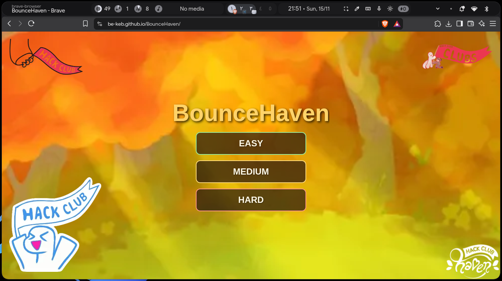

<h1>
<bold>BounceHaven</bold>
</h1>

  

  <strong>A 2d game built for HackClub Haven</strong>

  <a href="#demo">Demo</a> &bull;
  <a href="#ai-usage">AI Usage</a> &bull;
  <a href="#tech-stack">Teck Stack</a> 

---

## Overview
BounceHaven is a interactive 2d game built for Hack Club Haven. The game is built around the theme "BounceBack"
 
 

## Demo

[Live Demo](https://be-keb.github.io/) &mdash; Try the game
 
 

## AI Usage

I mostly used AI for the microphone part (the voice to jump physics) and for the bouncing physics, cause i have never used microphone input in any of my projects before, let alone converting the sound into jumps!
(Even the microphone code isnt fully AI generated, i did some changes to it according to my needs)

### Tech Stack

1. HTML5
2. CSS3
3. JavaScript
4. Canvas API
5. WebAudio API
6. Media Devices API
